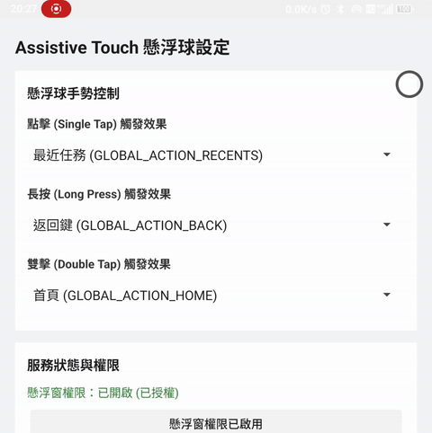

# AssistiveTouch 懸浮球

## Features
### 單擊/雙擊/長按 可分別設定

* 最近應用 GLOBAL_ACTION_RECENTS
* 返回 GLOBAL_ACTION_BACK
* 主頁 GLOBAL_ACTION_HOME
* 下拉通知欄 GLOBAL_ACTION_NOTIFICATIONS
* 快捷設定 GLOBAL_ACTION_QUICK_SETTINGS
* 電源選單 GLOBAL_ACTION_POWER_DIALOG
* 截圖 GLOBAL_ACTION_TAKE_SCREENSHOT
* 鎖屏 GLOBAL_ACTION_LOCK_SCREEN
* 關閉通知 GLOBAL_ACTION_DISMISS_NOTIFICATION_SHADE
* 切換分屏 GLOBAL_ACTION_TOGGLE_SPLIT_SCREEN (新的安卓版本失效)

### 預設值
* 單擊 GLOBAL_ACTION_RECENTS
* 長壓 GLOBAL_ACTION_BACK
* 雙擊 GLOBAL_ACTION_HOME
